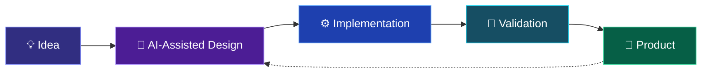

# Hi, I'm kodam 👋

### Software Architect · Backend Engineer · AI Builder

**Designing systems. Building products. Exploring what's next.**

---

## 👨‍💻 About Me

I'm a software architect and backend engineer based in Japan.

My primary expertise lies in designing and building backend systems,
particularly in domains where **reliability, scalability, and
maintainability** matter.

My engineering interests have evolved from backend development
and distributed systems toward **AI-native software development**.

I enjoy exploring how emerging technologies can reshape
the way we design, build, and interact with software.

## 🛠️ Tech Stack

### Languages & Runtime

### Backend & Infrastructure

### AI & Developer Tools

---

## 🧠 Engineering Focus

<table>
<tr>
<td width="50%" valign="top">

### 🏗️ System Architecture

Designing systems that balance complexity, performance, and maintainability.

- Backend architecture
- Distributed systems
- API design
- Reliability & observability
- Payment infrastructure

</td>
<td width="50%" valign="top">

### 🤖 AI Engineering

Exploring practical applications of generative AI and local inference.

- LLM integration
- AI agents & automation
- Local LLM infrastructure
- Speech synthesis & TTS
- AI-assisted development

</td>
</tr>
<tr>
<td width="50%" valign="top">

### ⚡ Developer Experience

Improving how software is developed, operated, and maintained.

- Development automation
- CI/CD workflows
- Infrastructure tooling
- Monitoring & diagnostics
- Developer productivity

</td>
<td width="50%" valign="top">

### 🚀 Product Engineering

Turning ideas into working software through rapid experimentation.

- Rapid prototyping
- Web application development
- AI-native interfaces
- Product architecture
- Iterative development

</td>
</tr>
</table>

---

## 🚀 What I'm Exploring

### AI-Native Software Development

I'm particularly interested in the transition from
traditional software engineering to AI-native development.

Not just using AI to write code, but rethinking the entire
software development lifecycle around intelligent tools.

### Current Interests

| Area | What interests me |
|:---|:---|
| 🤖 AI Agents | Autonomous workflows and intelligent automation |
| 🧠 Local LLMs | Private, self-hosted AI infrastructure |
| 🎙️ Speech AI | TTS, voice generation, and audio production |
| 🏗️ Architecture | Designing reliable and maintainable systems |
| 🎮 Creative Tech | Game development and generative content |
| 🔧 Developer Tools | Making software development more efficient |

---

## 🧪 My Personal Lab

I enjoy building experimental tools and exploring new technologies.

Some areas I've been working on:

**🎙️ AI Audio Production**

Exploring tools for AI-assisted audio production,
including speech synthesis, scenario editing,
and timeline-based audio workflows.

**🧠 Personal AI Infrastructure**

Experimenting with local LLMs, AI agents,
workflow automation, and self-hosted services.

**📚 AI-Powered Knowledge Systems**

Building workflows that collect, summarize,
organize, and retrieve information using AI.

**🎮 Experimental Game Development**

Exploring procedural systems, roguelike mechanics,
and AI-assisted game creation.

---

## 📊 GitHub Activity

  <table>
    <tr>
      <td>
        
      </td>
      <td>
        
      </td>
    </tr>
  </table>

> GitHub statistics reflect public activity and may not represent
> my professional engineering work.

---

### Thanks for visiting! 👋

*Always learning. Always building.*

[🌐 Website](https://oppai.ninja) ·
[💻 GitHub](https://github.com/oppai) ·
[🏢 Professional History]([https://github.com/kodams](https://gist.github.com/oppai/5e10c6bd03c9d53f50564a369be2f940))

